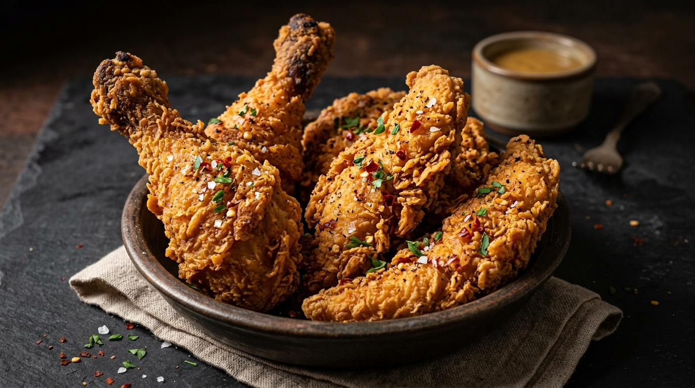

# C2 Chicken — Modern Restaurant Website Sample

A responsive restaurant sample and digital proposal website for **C2 Chicken**, a local fried chicken takeaway shop based in Cuddalore, Tamil Nadu.



## 📌 Project Overview
This website was built to complement the authentic brand identity of **C2 Chicken** (bold red storefront and branding) while providing an intuitive, mobile-first experience for local customers looking for quick takeaway and phone ordering.

- **Business Name:** C2 Chicken
- **Category:** Fried Chicken Takeaway
- **Location:** 19F, Nellikuppam Main Road, Vinayaga Nagar, Chavadi, Kondur, Cuddalore, Tamil Nadu 607006
- **Phone:** 087787 09733 (`+918778709733`)
- **Rating Reference:** Verified Google Rating 4.6 / 5 (37 reviews)
- **Status:** Concept sample / website proposal ready for owner review

---

## 🍗 Key Features

1. **Brand-Complementary Design:**
   - Primary Brand Red (`#D71920`)
   - Sleek Dark Backdrop (`#151313`) & Warm Light Accents (`#FFF8F5`)
   - Bold typography using Google Fonts (*Outfit* and *Plus Jakarta Sans*)
   - Subtle hover micro-animations and rounded food cards

2. **Full Responsive Experience:**
   - Clean sticky navigation bar with blurred backdrop
   - Mobile navigation drawer with smooth animations and keyboard accessibility (`ESC` key support)
   - Mobile floating action bar with instant 1-tap **Call** and **Directions** buttons

3. **Popular Menu Categories:**
   - **Fried Chicken**
   - **Chicken Burgers**
   - **Breaded Prawns**
   - **Mojitos & Beverages**
   - Interactive category filter tabs (All Items, Fried Chicken, Burgers, Prawns, Drinks)
   - Transparent pricing notices (*"Ask us for today's price"*) adhering strictly to verified listing information without invented prices

4. **Authentic Business Details:**
   - Verified Google Rating scorecard (4.6 / 5 based on 37 reviews)
   - Excerpts from verified customer feedback
   - Interactive embedded Google Maps & direct navigation button
   - International click-to-call link (`tel:+918778709733`)
   - Clear operating hours notice (*Closes at 10:00 PM; timings subject to confirmation with owner*)

5. **Performance & Standards:**
   - 100% Vanilla stack: HTML5, CSS3, ES6+ JavaScript
   - Zero external framework dependencies (no React, Tailwind, or bundlers needed)
   - Accessible color contrast, semantic HTML, and `prefers-reduced-motion` compliance

---

## 📁 Project Structure

```text
C2-Chicken/
├── images/
│   ├── c2-logo.png             # Official C2 Chicken brand emblem logo
│   ├── hero-chicken.jpg        # Hero banner photography
│   ├── fried-chicken.jpg       # Fried chicken category card
│   ├── chicken-burger.jpg      # Chicken burger category card
│   ├── breaded-prawns.jpg      # Breaded prawns category card
│   ├── mojitos-beverages.jpg   # Beverages & coolers card
│   └── about-takeaway.jpg      # Takeaway kitchen feature image
├── index.html                  # Semantic HTML5 markup
├── style.css                   # Core & desktop CSS design system
├── mobile.css                  # Dedicated mobile stylesheet (media <= 768px)
├── script.js                   # Mobile drawer, scroll reveal, menu filter
└── README.md                   # Documentation
```

---

## 🚀 How to Run Locally

You do not need any compilers, node modules, or build steps.

### Option 1: Direct in Browser
Double-click `index.html` to open it in any modern browser (Chrome, Edge, Firefox, Safari).

### Option 2: VS Code Live Server
1. Open the project folder in VS Code.
2. Install the **Live Server** extension.
3. Right-click `index.html` and select **"Open with Live Server"**.

### Option 3: Python Simple HTTP Server
In your terminal, run:
```bash
python -m http.server 5500
```
Then navigate to `http://localhost:5500` in your browser.

---

## 📄 License
This project is created as a digital sample and presentation concept for C2 Chicken, Cuddalore. All rights reserved.
